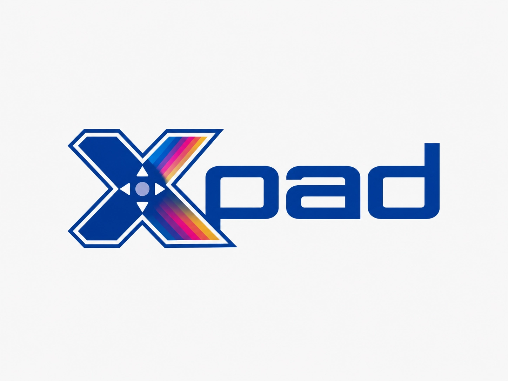

<!-- SPDX-License-Identifier: BSD-2-Clause -->
<!-- SPDX-FileCopyrightText: 2026 Neil Rackett -->

# Xpad for Atari ST



Open standard for extended controller input for the Atari ST family,
by [Neil Rackett](https://neilrackett.com/atarist)

## Introduction

The ST's joystick ports know about four directions and one fire button.
Xpad lets ST software see everything a modern gamepad has instead:
every button, both analogue sticks and the triggers, for up to four
pads at once, with rumble too.

It's an open standard rather than a piece of hardware. A provider,
whatever connects your pads to the ST, publishes their state in a small
block of memory that it announces through the cookie jar, and games
read it once a frame. Neither end needs to know how the other works, so
anything written for Xpad works with every provider, and nothing is
replaced: your joystick and mouse carry on as before.

It's named after the Linux `xpad` driver, whose button naming it
follows.

## Providers

To use Xpad, you need a provider: the thing that connects your pads to
the ST. Only one can be installed at a time.

| Name | What it connects | You'll need |
| ---- | ---------------- | ----------- |
| [COMpad](https://github.com/neilrackett/pico-compad) | Up to four Bluetooth gamepads, with analogue sticks and rumble, through the serial port | A Raspberry Pi Pico W and a MAX3232 module |
| [MD/Sidepad](https://github.com/neilrackett/md-sidepad) | A Bluetooth gamepad, analogue sticks and all, through the cartridge port | A SidecarTridge Multi-device |

There are also five example drivers here. They're written to be read
and copied by anyone making a provider of their own, but they work too:

| Name | What it connects | File |
| ---- | ---------------- | ---- |
| [STEpad](src/drivers/stepad) | A Jaguar style pad in each of the enhanced joystick ports of an STE or Falcon | `XPADSTE.PRG` |
| [joymouse](src/drivers/joymouse) | A joystick in port 1 as one pad, with the left mouse button as its second button, on any ST, STE, TT or Falcon | `XPADJM.PRG` |
| [joystick](src/drivers/joystick) | Both joystick ports as two pads, each with one button, on any ST, STE, TT or Falcon | `XPADJOY.PRG` |
| [keyboard](src/drivers/keyboard) | The keyboard as one pad, using DOOM's default controls, with TOS 2.0 or later | `XPADKEY.PRG` |
| [DevOps](src/drivers/devops) | Up to four pads driven from your computer, for unattended tests and remote play, through md-devops firmware that's still in beta, so build this one yourself | `XPADDEV.PRG` |

What each driver does, and doesn't, is in
[docs/drivers.md](docs/drivers.md).

## Installation

1. Download what you need from the
   [latest release](https://github.com/neilrackett/atarist-xpad/releases/tag/latest),
   which is rebuilt whenever `main` changes.
2. Install a provider, following its own instructions, or copy one of
   the example drivers into the `AUTO` folder of your boot disk.
3. For games that weren't written for Xpad, copy `XPADEMU.PRG` into
   `AUTO` **after** the provider, and `XPADEMU.CFG` to the root of your
   boot drive if you want to change its settings. Skip this with the
   joymouse driver: its joystick and mouse already reach games directly,
   and the two together make its second button fire as well.
4. Run `XPADVIEW.PRG` to check everything's working.

## Usage

### Playing games

Software written for Xpad reads your pads directly, analogue sticks and
all.

For everything else, `XPADEMU.PRG` turns your first pad into a joystick
in port 1 and its right stick into the mouse, with your real joystick
and mouse still working alongside. Every button without another job
fires, west autofires, and clicking the right stick is the left mouse
button. All of that can be changed in `XPADEMU.CFG`, and
[docs/xpademu.md](docs/xpademu.md) has every setting.

### Checking your pads

`XPADVIEW.PRG` shows every button, stick and trigger on your pads live,
and tests rumble.

| Key     | Does                                    |
| ------- | --------------------------------------- |
| `1`-`4` | Choose which pad is shown               |
| `(`     | Rumble the left motor for half a second |
| `)`     | The same, right motor                   |
| `*`     | The same, both                          |
| `Q`     | Quit, and so does Escape                |

The three rumble keys are the top row of the numeric keypad. Run it as
`XPADVIEW -d` to see it working with a demo provider and no hardware at
all. There's more in [docs/xpadview.md](docs/xpadview.md).

### Xpong

`XPONG.TOS` is Pong for one player against the computer, two with a pad
each, or two sharing one pad, left stick against right, with rumble
wherever your provider offers it. It needs a colour monitor. How to
play, and what it shows anyone writing a game, is in
[docs/xpong.md](docs/xpong.md).

## Using Xpad in your software

Reading a pad takes two calls: find the block once, at startup, then
copy a pad each frame.

```c
const XPAD *pads = xpad_find();     /* once: NULL with no provider */
XPAD_PAD pad;

if (pads && xpad_read(pads, 0, &pad))       /* each frame */
{
    if (pad.buttons & XPAD_SOUTH)    jump();
    if (pad.flags & XPAD_PAD_ANALOG) aim(pad.rx, pad.ry);
}
```

Add this repository to your project as a submodule and build
`src/xpad.c` alongside your own sources; a provider takes
`src/xpad_provider.c` as well. You don't need anything from the
release.

One trap worth knowing straight away: `XPAD_X` is the **north** button
and `XPAD_Y` the **west**, following the Linux kernel, which is the
reverse of the letters on an Xbox pad. Use the positional names, such
as `XPAD_NORTH` and `XPAD_WEST`, in new code.

| Read | For |
| ---- | --- |
| [Specification](docs/specification.md) | How the block works: discovery, reading, writing, rumble, tearing, conventions and compatibility |
| [Integrating into a port](docs/integrating.md) | Adding Xpad to your build, falling back when there's no provider, and the licence notice |
| [Consuming from assembly](docs/assembly.md) | The generated equates, and a worked assembly consumer |
| [Example drivers](docs/drivers.md) | The five drivers in detail, and writing a provider of your own |
| [XPADEMU](docs/xpademu.md) | Every setting, how the injection works, and its limits |
| [XPADVIEW](docs/xpadview.md) | The reference consumer, and how it tests rumble |
| [Xpong](docs/xpong.md) | Edge detection, analogue with a digital fallback, and rumble that always stops |

## Known limitations

- Only one provider can be installed at a time, so COMpad, MD/Sidepad
  and the example drivers are alternatives rather than something to run
  together. The example drivers refuse to install when one is already
  there.
- `XPADEMU.PRG` reaches games through the system joystick and mouse
  handlers, so games that read the keyboard processor themselves, which
  includes many original floppy games, won't see your pad. Software
  written for Xpad is unaffected.
- None of the example drivers offers rumble. For that you need a
  provider such as COMpad.
- The example drivers pass their tests under Hatari, but haven't been
  run on real hardware yet.

## What's next?

- A fallback shim that does what the joymouse and keyboard drivers do
  in one, so a game can support Xpad alone and still work on a bare ST
  with a joystick, a mouse button and the keyboard.
- A provider driven by Hatari's emulated joysticks, so Xpad software
  can be developed without any hardware.
- More providers: anything that can fill the block, such as a MIDI,
  parallel port or mouse port adapter, gives every Xpad game support it
  never had to write.

Think you can help? Got an idea of your own? We'd love to hear from
you, so why not let me know on [X](https://x.com/neilrackett) or submit
a PR.

## Building

```bash
# Host tests: needs nothing but a C compiler
make

# Everything that runs on an ST, into dist/: needs atarist-toolkit-docker
STCMD_NO_TTY=1 stcmd make st

# Every test, including the emulated ones: needs Hatari and EmuTOS
./verify.sh
```

The ST programs are built with
[atarist-toolkit-docker](https://github.com/sidecartridge/atarist-toolkit-docker),
which provides `stcmd`.

### Layout

| Path            | Contents                                                                 |
| --------------- | ------------------------------------------------------------------------ |
| `src/`          | `xpad.h`, `xpad.c` and `xpad_provider.c`: the standard and its reference implementation |
| `src/drivers/`  | The five example drivers                                                 |
| `src/tools/`    | `XPADEMU`, `XPADVIEW`, and the generator for the assembler equates       |
| `examples/`     | A worked assembly consumer, and Xpong                                    |
| `docs/`         | The specification, and everything else in detail                         |
| `test/`         | Host tests, and the harness that runs ST programs under Hatari           |

Working practices for contributors are in [AGENTS.md](AGENTS.md).

## Licence

BSD-2-Clause. Chosen so that any provider or consumer can adopt it
regardless of its own licence, which matters more for an interface than
for an implementation. In particular it stays compatible with GPL-2-only
codebases, which several Atari ST ports are.

Providers and tools built on Xpad are free to be copyleft. Only this
header and its reference implementation, which get compiled into other
people's programs, need to be permissive.

Copyright (c) 2026 Neil Rackett.
